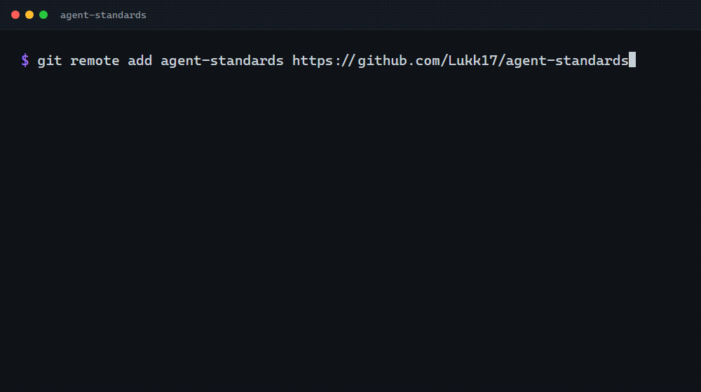
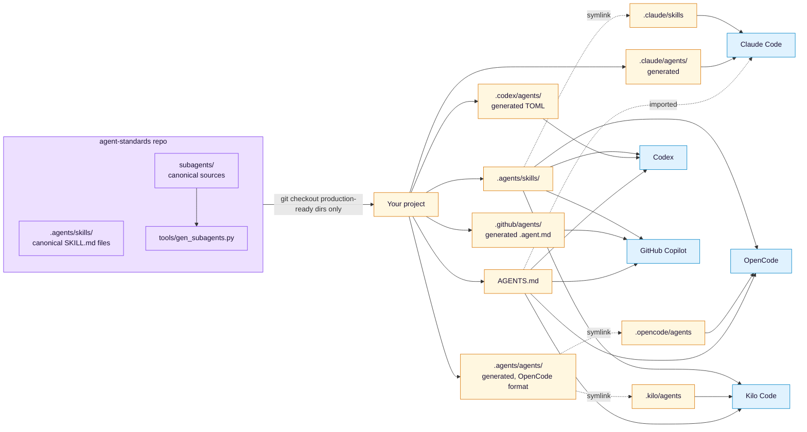
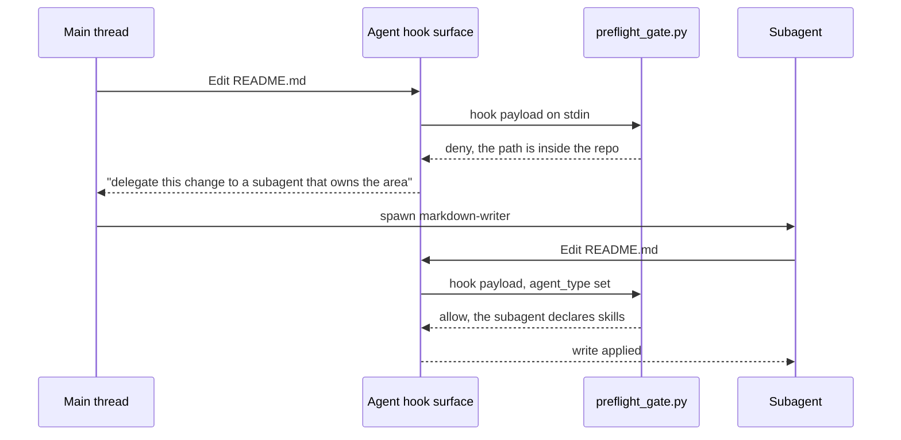

<div align="center">

# Agent Standards

One `git checkout` drops a shared AI coding setup (skills, subagents, MCP servers, OpenSpec scaffolding) into any
project.

[](https://github.com/Lukk17/agent-standards)
[](.agents/skills/)
[](subagents/)
[](docs/MCP_SETUP.md)
[](docs/AGENT_TOOLING.md#openspec-integration)
[](https://github.com/Lukk17/agent-standards/actions/workflows/ci.yml)
[](LICENSE)
[](docs/repository-layout.md)



</div>

---

### Why it exists

For developers and teams running multiple AI coding agents across multiple repos. Every project drifts (different
prompt files, skill versions, MCP configs, subagent definitions). This repo is the single source: import once, pull
updates with one `git fetch`. Used across every project in the portfolio.

Consumer projects pull only production-ready content: skills, generated subagent files, the preflight gate, the MCP
configs, and the shipped docs. The canonical [subagents/](subagents/) source and [tools/](tools/) generator stay here.

The canonical source is [.agents/skills/](.agents/skills/), which Codex, OpenCode, Kilo Code, and every GitHub Copilot
surface read natively. The layout follows the cross-tool AGENTS.md and SKILL.md conventions, so the setup stays
portable across the supported agents rather than tied to one tool.

---

### Prerequisites

Four things. The first two matter in every project, the last two depend on your platform and on which agents you run.

- Git. The import is a selective checkout from a second remote, so nothing else installs the files.
- Python 3 on your path, under either name. Every hook in [.agents/hooks/](.agents/hooks/) is a Python script, and
  every wiring throws away a failed call so a broken gate can never break a session. Each POSIX wiring resolves
  `python3` first and falls back to `python`, which is the name the python.org installer puts on a Windows path, so
  either name is enough. With neither on the path the gate reads as an allow, which means it is silently off
  rather than loudly broken. Check before you trust it.
- Windows only: Developer Mode (Settings, System, For developers) plus git told to honour symlinks. The import holds
  symlinks, and without both git writes each one out as a text file holding its target path.
- Node, only if you run OpenCode or Kilo Code. Their gate adapter is
  [.agents/plugin/hooks.js](.agents/plugin/hooks.js), loaded by their own runtime. The other three agents need none.

Confirm the interpreter. PowerShell:

```powershell
python --version
```

Unix shell:

```bash
python3 --version
```

If that prints nothing, install Python 3 before you go on, or the gate will allow every call it was meant to block.

---

### Quickstart

On Windows, turn on Developer Mode first, then set the symlink option inside the project you are importing into.
PowerShell:

```powershell
git config core.symlinks true
```

Unix shell:

```bash
git config core.symlinks true
```

Adding `--global` to that command sets it once for every repository on the machine, including clones you have not
made yet, which is the form to use if you import the standards more than once.

Add the upstream remote. PowerShell:

```powershell
git remote add agent-standards https://github.com/Lukk17/agent-standards
```

Unix shell:

```bash
git remote add agent-standards https://github.com/Lukk17/agent-standards
```

Point its push URL at nothing, so a stray push cannot reach it. PowerShell:

```powershell
git remote set-url --push agent-standards no_push
```

Unix shell:

```bash
git remote set-url --push agent-standards no_push
```

Fetch it. PowerShell:

```powershell
git fetch agent-standards
```

Unix shell:

```bash
git fetch agent-standards
```

Check out the production-ready paths. They leave out `.claude/skills`, `.claude/agents` and `.claude/settings.json`, because Claude Code takes its skills, subagents and hooks from the plugin marketplace in the last three steps. PowerShell:

```powershell
git checkout agent-standards/master -- .agents .claude/workflows .opencode .kilo .codex .github/agents .github/hooks .vscode/mcp.json .mcp.json .github/mcp.json opencode.json .metrics/tools docs/AGENT_TOOLING.md docs/MCP_SETUP.md docs/GLOBAL_SETUP.md docs/AGENTS-UPDATE.md AGENTS.md.example
```

Unix shell:

```bash
git checkout agent-standards/master -- .agents .claude/workflows .opencode .kilo .codex .github/agents .github/hooks .vscode/mcp.json .mcp.json .github/mcp.json opencode.json .metrics/tools docs/AGENT_TOOLING.md docs/MCP_SETUP.md docs/GLOBAL_SETUP.md docs/AGENTS-UPDATE.md AGENTS.md.example
```

Rename the one template. PowerShell:

```powershell
Rename-Item AGENTS.md.example AGENTS.md
```

Unix shell:

```bash
mv AGENTS.md.example AGENTS.md
```

Add the agent task list to your own ignore file, because the task-list hook writes it every session. PowerShell:

```powershell
Add-Content .gitignore "`n/tasks.md"
```

Unix shell:

```bash
printf '\n/tasks.md\n' >> .gitignore
```

Claude Code takes its skills, subagents and hooks as plugins, not from the checkout. Skip these three steps in a project that never runs Claude Code. Add the marketplace to the project. PowerShell or Unix shell, same command:

```bash
claude plugin marketplace add Lukk17/agent-standards --scope project
```

Install `core` and every development domain, or one domain such as `python` in its place:

```bash
claude plugin install all@agent-standards --scope project
```

Install the hooks, the preflight gate included:

```bash
claude plugin install hooks-all@agent-standards --scope project
```

Claude Code has its own route because of double loading. It loads a project skill and a plugin skill of the same name side by side, "because plugin skills are namespaced as `/plugin-name:skill-name`" ([skills docs](https://code.claude.com/docs/en/skills), "Resolve skills that share a name", read 2026-11-23), so a project that both checks out `.claude` and installs the plugins lists every skill twice, once as `/python-patterns` and once as `/python-patterns:python-patterns`. The other four agents have no such marketplace and keep the Git import.

That's it. Open the project in Claude Code, Kilo Code, OpenCode, Codex, or GitHub Copilot and skills are live. On
OpenCode 1.x, first copy `.opencode/opencode.json.v1` over `.opencode/opencode.json`, as the OpenCode section below
shows, because 1.x refuses to start on the 2.x form the default ships in.

The MCP config files arrive as real files, ready to use, so nothing else needs renaming:
[.mcp.json](.mcp.json) for Claude Code and the Copilot CLI, which holds `context7` alone so Claude Code starts one server by default ([why, and how to add the others](docs/MCP_SETUP.md#what-ships)), [opencode.json](opencode.json) for OpenCode and Kilo Code,
[.codex/config.toml](.codex/config.toml) for Codex, [.vscode/mcp.json](.vscode/mcp.json) for Copilot in VS Code, and
[.github/mcp.json](.github/mcp.json), the Copilot CLI fallback for a folder that has no `.mcp.json`. `AGENTS.md.example` is the only template left in the repo.

Human-side MCP setup (keys, environment variables, the two Copilot surfaces that get no file) lives in
[docs/MCP_SETUP.md](docs/MCP_SETUP.md).

Full walkthrough lives in [docs/AGENT_TOOLING.md](docs/AGENT_TOOLING.md).

---

### Per-agent setup

The Quickstart above is the recommended path and stays right for most projects: it pulls the whole setup once,
installs the Claude Code plugins, and every agent then finds what it reads. If a project only ever sees one agent, the subsection for that agent pulls just
its share instead.

Run the first three Quickstart commands once so the read-only remote exists (`git remote add`,
`git remote set-url --push agent-standards no_push`, and `git fetch agent-standards`), then follow the single
subsection you need. Adding a second agent later is nothing more than running its subsection too, because the shared
paths are the same files.

#### Claude Code

Claude Code 2.1.277 and later reads `AGENTS.md` natively, but only while the project holds no `CLAUDE.md`, so this
setup ships none and you add none ([why](docs/AGENT_TOOLING.md#instruction-files)). It takes its skills, subagents and hooks as plugins from the marketplace in [.claude-plugin/marketplace.json](.claude-plugin/marketplace.json), described under [Claude Code plugins](#claude-code-plugins). The Git checkout brings only what no plugin can carry: the `AGENTS.md` template, the `context7` server in [.mcp.json](.mcp.json) and the shipped documents.

Do not check out `.claude` or `.agents/skills` for Claude Code as well. Claude Code loads a project skill and a plugin skill of the same name side by side, "because plugin skills are namespaced as `/plugin-name:skill-name`" ([skills docs](https://code.claude.com/docs/en/skills), "Resolve skills that share a name", read 2026-11-23), so a project with both lists every skill twice, once as `/python-patterns` and once as `/python-patterns:python-patterns`. Nothing here is a symlink, so Windows needs neither Developer Mode nor `git config core.symlinks true`.

Pull the template, the MCP file and the documents. PowerShell or Unix shell, same command:

```bash
git checkout agent-standards/master -- .mcp.json AGENTS.md.example docs/AGENT_TOOLING.md docs/MCP_SETUP.md docs/GLOBAL_SETUP.md docs/AGENTS-UPDATE.md
```

Rename the template so Claude Code reads it as `AGENTS.md`. PowerShell:

```powershell
Rename-Item AGENTS.md.example AGENTS.md
```

Unix shell:

```bash
mv AGENTS.md.example AGENTS.md
```

Add the marketplace to the project. PowerShell or Unix shell, same command, here and in the next two steps:

```bash
claude plugin marketplace add Lukk17/agent-standards --scope project
```

Install `core` and every development domain, or one domain such as `python` in its place:

```bash
claude plugin install all@agent-standards --scope project
```

Install the hooks, the preflight gate included:

```bash
claude plugin install hooks-all@agent-standards --scope project
```

Project scope writes the marketplace and each plugin into the project's `.claude/settings.json`. Commit that file, and each contributor runs the two install commands once in their own clone. [.mcp.json](.mcp.json) starts `context7` alone. Add each other server the project uses as its own plugin at project scope or with `claude mcp add --scope project`, as [docs/MCP_SETUP.md](docs/MCP_SETUP.md#adding-a-server-to-claude-code) shows.

To update later, refresh the marketplace and update the plugins, with the two commands under [Claude Code plugins](#claude-code-plugins). Refresh the documents with the checkout above without `.mcp.json` and `AGENTS.md.example`, which became yours at import. PowerShell or Unix shell, same command:

```bash
git checkout agent-standards/master -- docs/AGENT_TOOLING.md docs/MCP_SETUP.md docs/GLOBAL_SETUP.md docs/AGENTS-UPDATE.md
```

#### Codex

Codex reads `AGENTS.md` and [.agents/skills/](.agents/skills/) natively, and it follows symlinks while scanning
them, so nothing has to be bridged. Custom agents come from [.codex/agents/](.codex/agents/) as TOML,
and [.codex/config.toml](.codex/config.toml) carries both the `[mcp_servers]` tables and the preflight hooks as inline
`[[hooks.*]]` tables. No symlink is involved in this set, so Windows needs neither Developer Mode nor
`git config core.symlinks true`.

Pull what Codex reads. PowerShell:

```powershell
git checkout agent-standards/master -- .agents/skills .agents/hooks .codex AGENTS.md.example .metrics/tools docs/AGENT_TOOLING.md docs/MCP_SETUP.md docs/GLOBAL_SETUP.md docs/AGENTS-UPDATE.md
```

Unix shell:

```bash
git checkout agent-standards/master -- .agents/skills .agents/hooks .codex AGENTS.md.example .metrics/tools docs/AGENT_TOOLING.md docs/MCP_SETUP.md docs/GLOBAL_SETUP.md docs/AGENTS-UPDATE.md
```

Rename the template. PowerShell:

```powershell
Rename-Item AGENTS.md.example AGENTS.md
```

Unix shell:

```bash
mv AGENTS.md.example AGENTS.md
```

Codex loads a project's `.codex/` layer only after you trust the project once, so approve it on first run or none of
the hooks and none of the MCP servers apply.

To update later, fetch first. PowerShell:

```powershell
git fetch agent-standards
```

Unix shell:

```bash
git fetch agent-standards
```

Then pull upstream's half back. `.codex/config.toml` stays out of it, because your MCP servers and the hook tables
share that one file, so take an upstream change to its hook tables with the `.codex/config.toml` command under
[Taking only the gate half](docs/AGENTS-UPDATE.md#taking-only-the-gate-half). PowerShell:

```powershell
git checkout agent-standards/master -- .agents/skills .agents/hooks .codex/agents .metrics/tools docs/AGENT_TOOLING.md docs/MCP_SETUP.md docs/GLOBAL_SETUP.md docs/AGENTS-UPDATE.md
```

Unix shell:

```bash
git checkout agent-standards/master -- .agents/skills .agents/hooks .codex/agents .metrics/tools docs/AGENT_TOOLING.md docs/MCP_SETUP.md docs/GLOBAL_SETUP.md docs/AGENTS-UPDATE.md
```

#### OpenCode

OpenCode reads `AGENTS.md` and [.agents/skills/](.agents/skills/) natively. Subagents arrive through the
`.opencode/agents` symlink into [.agents/agents/](.agents/agents/). [opencode.json](opencode.json) at the
project root declares the gate plugin by path in its `plugin` array and carries the MCP servers under its `mcp` key.
That file has to stay at the root, because Kilo Code reads only the root one.
[.opencode/opencode.json](.opencode/opencode.json) carries nothing but a native edit backstop, which denies the main
session an edit of any project file but `tasks.md` where the plugin gate never fires. It is written in the OpenCode 2.x
`permissions` form, which OpenCode 1.x refuses to start on, so
[.opencode/opencode.json.v1](.opencode/opencode.json.v1) ships beside it with the same rule in the 1.x form.

`.opencode/agents` is a symlink, so Windows needs Developer Mode on (Settings, System, For developers) and git told to
honour symlinks, or OpenCode ends up with no subagents. PowerShell:

```powershell
git config core.symlinks true
```

The Unix shells need nothing here.

Pull what OpenCode reads. PowerShell:

```powershell
git checkout agent-standards/master -- .agents/skills .agents/agents .agents/hooks .agents/plugin .opencode opencode.json AGENTS.md.example .metrics/tools docs/AGENT_TOOLING.md docs/MCP_SETUP.md docs/GLOBAL_SETUP.md docs/AGENTS-UPDATE.md
```

Unix shell:

```bash
git checkout agent-standards/master -- .agents/skills .agents/agents .agents/hooks .agents/plugin .opencode opencode.json AGENTS.md.example .metrics/tools docs/AGENT_TOOLING.md docs/MCP_SETUP.md docs/GLOBAL_SETUP.md docs/AGENTS-UPDATE.md
```

Rename the template. PowerShell:

```powershell
Rename-Item AGENTS.md.example AGENTS.md
```

Unix shell:

```bash
mv AGENTS.md.example AGENTS.md
```

On OpenCode 1.x, put the 1.x backstop in place, and again after any checkout that names `.opencode`. OpenCode 2.x and
Kilo Code need nothing here. PowerShell:

```powershell
Copy-Item .opencode/opencode.json.v1 .opencode/opencode.json
```

Unix shell:

```bash
cp .opencode/opencode.json.v1 .opencode/opencode.json
```

To update later, fetch first. PowerShell:

```powershell
git fetch agent-standards
```

Unix shell:

```bash
git fetch agent-standards
```

Then pull upstream's half back. `opencode.json` stays out, because it holds your MCP servers and the plugin
declaration together. PowerShell:

```powershell
git checkout agent-standards/master -- .agents/skills .agents/agents .agents/hooks .agents/plugin .metrics/tools docs/AGENT_TOOLING.md docs/MCP_SETUP.md docs/GLOBAL_SETUP.md docs/AGENTS-UPDATE.md
```

Unix shell:

```bash
git checkout agent-standards/master -- .agents/skills .agents/agents .agents/hooks .agents/plugin .metrics/tools docs/AGENT_TOOLING.md docs/MCP_SETUP.md docs/GLOBAL_SETUP.md docs/AGENTS-UPDATE.md
```

#### Kilo Code

Kilo Code works like OpenCode. It reads `AGENTS.md` and [.agents/skills/](.agents/skills/) natively, takes its
subagents through the `.kilo/agents` symlink into [.agents/agents/](.agents/agents/), and accepts
the root [opencode.json](opencode.json) as a project config file, so it picks up the gate plugin and the MCP block
from the same file OpenCode uses.

Kilo is stricter than OpenCode about substitution. A `{env:VAR}` anywhere in a project config file is a fatal error
for Kilo, and it rejects that entire file rather than leaving the token literal, which would cost it the MCP servers
and the gate plugin in one go. The shipped `opencode.json` therefore carries no tokens at all. Local servers still get
their secrets, because both tools start them with the environment of the process that started the agent, so exporting
the variable is enough. The single value that cannot be inherited is the Context7 API key, which travels in an HTTP
header, so `context7` ships unauthenticated on the free tier. Adding a paid key is a global-config change, described
in [docs/MCP_SETUP.md](docs/MCP_SETUP.md).

`.kilo/agents` is a symlink, so Windows needs Developer Mode on (Settings, System, For developers) and git told to
honour symlinks, or Kilo Code ends up with no subagents. PowerShell:

```powershell
git config core.symlinks true
```

The Unix shells need nothing here.

Pull what Kilo Code reads. PowerShell:

```powershell
git checkout agent-standards/master -- .agents/skills .agents/agents .agents/hooks .agents/plugin .kilo opencode.json AGENTS.md.example .metrics/tools docs/AGENT_TOOLING.md docs/MCP_SETUP.md docs/GLOBAL_SETUP.md docs/AGENTS-UPDATE.md
```

Unix shell:

```bash
git checkout agent-standards/master -- .agents/skills .agents/agents .agents/hooks .agents/plugin .kilo opencode.json AGENTS.md.example .metrics/tools docs/AGENT_TOOLING.md docs/MCP_SETUP.md docs/GLOBAL_SETUP.md docs/AGENTS-UPDATE.md
```

Rename the template. PowerShell:

```powershell
Rename-Item AGENTS.md.example AGENTS.md
```

Unix shell:

```bash
mv AGENTS.md.example AGENTS.md
```

To update later, fetch first. PowerShell:

```powershell
git fetch agent-standards
```

Unix shell:

```bash
git fetch agent-standards
```

Then pull upstream's half back, leaving `opencode.json` alone for the same reason as OpenCode. PowerShell:

```powershell
git checkout agent-standards/master -- .agents/skills .agents/agents .agents/hooks .agents/plugin .metrics/tools docs/AGENT_TOOLING.md docs/MCP_SETUP.md docs/GLOBAL_SETUP.md docs/AGENTS-UPDATE.md
```

Unix shell:

```bash
git checkout agent-standards/master -- .agents/skills .agents/agents .agents/hooks .agents/plugin .metrics/tools docs/AGENT_TOOLING.md docs/MCP_SETUP.md docs/GLOBAL_SETUP.md docs/AGENTS-UPDATE.md
```

#### GitHub Copilot

Copilot reads `AGENTS.md` and [.agents/skills/](.agents/skills/) natively on every surface: VS Code, the JetBrains
plugin, the CLI, and the cloud agent. No bridge file, and no symlink either, so Windows needs
neither Developer Mode nor `git config core.symlinks true`. Subagents have to be Copilot's own `*.agent.md` format in
[.github/agents/](.github/agents/), and the gate rides [.github/hooks/preflight.json](.github/hooks/preflight.json)
with camelCase event names. The JetBrains plugin reads `AGENTS.md` in agent mode too, per the March 2026 changelog,
even though GitHub's published support matrix still leaves JetBrains out of that column.

MCP is the part that splits per surface. The CLI reads [.mcp.json](.mcp.json), the file Claude Code reads, and
expands its `${VAR:-default}` entries, measured on Copilot CLI 1.0.103 on 2026-10-25. VS
Code needs [.vscode/mcp.json](.vscode/mcp.json). The JetBrains plugin reads a global path only and gets no project
file at all, and the cloud agent takes JSON pasted into a repository settings page. Both manual blocks live in
[docs/MCP_SETUP.md](docs/MCP_SETUP.md).

[.github/mcp.json](.github/mcp.json) is kept only as a fallback. The CLI reads it only in a folder that has no
[.mcp.json](.mcp.json), because when both files are in one folder it reads `.mcp.json` and not `.github/mcp.json` at
all, measured on 1.0.103 on 2026-10-25. The full Quickstart above pulls both files, so there the CLI reads
[.mcp.json](.mcp.json), which holds `context7` alone. The Copilot block below pulls only [.github/mcp.json](.github/mcp.json), so there the CLI reads
the fallback with the full server set. Measurement and full detail: [docs/MCP_SETUP.md](docs/MCP_SETUP.md#the-cli-mcpjson-and-why-a-fifth-file-exists).

Pull what Copilot reads. PowerShell:

```powershell
git checkout agent-standards/master -- .agents/skills .agents/hooks .github/agents .github/hooks .vscode/mcp.json .github/mcp.json AGENTS.md.example .metrics/tools docs/AGENT_TOOLING.md docs/MCP_SETUP.md docs/GLOBAL_SETUP.md docs/AGENTS-UPDATE.md
```

Unix shell:

```bash
git checkout agent-standards/master -- .agents/skills .agents/hooks .github/agents .github/hooks .vscode/mcp.json .github/mcp.json AGENTS.md.example .metrics/tools docs/AGENT_TOOLING.md docs/MCP_SETUP.md docs/GLOBAL_SETUP.md docs/AGENTS-UPDATE.md
```

Rename the template. PowerShell:

```powershell
Rename-Item AGENTS.md.example AGENTS.md
```

Unix shell:

```bash
mv AGENTS.md.example AGENTS.md
```

To update later, fetch first. PowerShell:

```powershell
git fetch agent-standards
```

Unix shell:

```bash
git fetch agent-standards
```

Then pull upstream's half back, leaving both MCP files alone because they are yours after the import. PowerShell:

```powershell
git checkout agent-standards/master -- .agents/skills .agents/hooks .github/agents .github/hooks .metrics/tools docs/AGENT_TOOLING.md docs/MCP_SETUP.md docs/GLOBAL_SETUP.md docs/AGENTS-UPDATE.md
```

Unix shell:

```bash
git checkout agent-standards/master -- .agents/skills .agents/hooks .github/agents .github/hooks .metrics/tools docs/AGENT_TOOLING.md docs/MCP_SETUP.md docs/GLOBAL_SETUP.md docs/AGENTS-UPDATE.md
```

#### Once you have customised the set

The update commands above pull every skill and subagent back, including ones you deleted on purpose. As soon as you
start adding or removing skills locally, switch to the selective refresh in
[docs/AGENTS-UPDATE.md](docs/AGENTS-UPDATE.md), which refreshes only what is already in your working tree.

---

### Claude Code plugins

Claude Code takes its skills, subagents and hooks as plugins from the marketplace in [.claude-plugin/marketplace.json](.claude-plugin/marketplace.json) on `master`, and its MCP servers too, so a project installs only what it uses. Every skill, every subagent, every Claude Code hook and every MCP server is its own plugin with its own version, and bundles install a group of them by name. Every hook is selectable, the reminders printed at session start, on each prompt and when a subagent starts included. A plugin cannot add `AGENTS.md`, so a project on the plugins takes it from the [Git import](#the-git-import-beside-the-plugins) below or from the global install in [docs/GLOBAL_SETUP.md](docs/GLOBAL_SETUP.md).

| Plugin | What it installs |
| --- | --- |
| The skill's own name, such as `python-patterns` or `quality-loop` | That one skill. `quality-loop` also carries Robert C. Martin's tools from [.metrics/tools/](.metrics/tools/) |
| `agent-<name>`, such as `agent-python-pro` | That one subagent and every skill it preloads |
| `hook-<name>`, such as `hook-preflight-gate` or `hook-preflight-reminder` | One Claude Code hook, wired with the same events, matchers and timeouts as [.claude/settings.json](.claude/settings.json). `hook-preflight-reminder`, `hook-background-subagent-reminder` and `hook-subagent-reminder` print its three reminders |
| `mcp-<server>`, such as `mcp-mongodb` | One MCP server, on a pinned version. Install it at project scope only |
| `core` | The skills that subagents in two or more domains preload |
| `python`, `jvm`, `go`, `backend`, `data`, `web-frontend`, `mobile`, `devops`, `review-and-security`, `testing`, `docs-and-product`, `embedded`, `game`, `agent-tooling` | One domain each: its subagents, the skills only they use, and `core` |
| `linux`, `windows-and-mac`, `homelab`, `personal-tools` | Host and tool skill groups |
| `hooks-all` | Every hook plugin |
| `mcp-all` | Every MCP server plugin |
| `all` | `core` and every domain. The host groups, the hooks and the MCP servers stay separate installs |

A bundle holds no files of its own. It lists plugin names, and installing it installs each of them. The plugins come straight from the files on `master`, and every change to one raises its version, so an update moves only the plugins that changed. Each version is also tagged `<name>--v<version>`.

Every command below installs at project scope, which records the marketplace and the plugin in the project's `.claude/settings.json` for everyone who works there. A plugin that carries an MCP server must be installed at project scope and never at user scope, the default of `claude plugin install`, because a plugin at user scope is on in every project on the machine and its server would start in every chat. The reason and the vendor quotes are in [docs/MCP_SETUP.md](docs/MCP_SETUP.md#adding-a-server-to-claude-code). A bundle that carries no server may also be installed with the user scope, for every project on the machine: `core` and the bundles you use in every project, never `all`, and never `mcp-all` or an `mcp-<server>` plugin. [docs/GLOBAL_SETUP.md](docs/GLOBAL_SETUP.md#claude-code) has those commands, the listing sizes behind the choice, and what `hooks-all` with the user scope switches on in every project.

Add the marketplace to the project once:

```bash
claude plugin marketplace add Lukk17/agent-standards --scope project
```

The marketplace that lived on the `plugins` branch, added as `Lukk17/agent-standards#plugins`, is retired and no longer updated. If you added it, remove it, then add the one above, which reads `master`, and install your plugins again under their new names:

```bash
claude plugin marketplace remove agent-standards
```

Install one skill:

```bash
claude plugin install python-patterns@agent-standards --scope project
```

Install one subagent. The skills it preloads come along:

```bash
claude plugin install agent-python-pro@agent-standards --scope project
```

Install one hook, such as the preflight gate:

```bash
claude plugin install hook-preflight-gate@agent-standards --scope project
```

Install one MCP server, here `mongodb`. A project that has no `.mcp.json` installs `mcp-context7` the same way:

```bash
claude plugin install mcp-mongodb@agent-standards --scope project
```

Install one domain:

```bash
claude plugin install python@agent-standards --scope project
```

Install `core` and every domain in one go:

```bash
claude plugin install all@agent-standards --scope project
```

Install every hook:

```bash
claude plugin install hooks-all@agent-standards --scope project
```

`mcp-all` installs every MCP server plugin at once, and all nine servers then start with every session in that project, so install it only where the project uses all of them:

```bash
claude plugin install mcp-all@agent-standards --scope project
```

Claude Code does not refresh this marketplace in the background, because auto-update is off by default for a marketplace outside Anthropic's own. Refresh the marketplace first:

```bash
claude plugin marketplace update agent-standards
```

Then update each plugin you installed, such as:

```bash
claude plugin update agent-python-pro@agent-standards
```

Project scope writes two keys into that project's `.claude/settings.json`, measured with Claude Code 2.1.325 on 2026-11-23. Commit the file to give everyone on the project the same set. Claude Code registers the marketplace only after a contributor accepts the workspace trust dialog for the folder:

```json
{
  "extraKnownMarketplaces": {
    "agent-standards": {
      "source": { "source": "github", "repo": "Lukk17/agent-standards" }
    }
  },
  "enabledPlugins": {
    "python@agent-standards": true,
    "hook-preflight-gate@agent-standards": true
  }
}
```

Every component is namespaced under its plugin, so the Python subagent is `agent-python-pro:python-pro` and the Python skill is `/python-patterns:python-patterns`. Each plugin installs only its own folder, so a project that both imports `.claude/` and enables the plugins carries two copies of each skill and subagent, one under each name. That double loading is why the plugins are the one route for Claude Code, and why the Git import in the [Quickstart](#quickstart) leaves `.claude/skills` and `.claude/agents` out and serves the other agents.

The GitHub Copilot CLI reads a marketplace from `.claude-plugin/` too: it "also looks for the `marketplace.json` file in the `.claude-plugin/` directory" ([Copilot CLI plugin reference](https://docs.github.com/en/copilot/reference/copilot-cli-reference/cli-plugin-reference)). It takes the skill plugins and the MCP server plugins from it and nothing else, because its plugin agents are `.agent.md` files and its hooks use their own format. Copilot keeps its subagents and hooks from the git import.

#### The hooks as plugins

Each hook plugin runs the hook's script from the plugin's own folder, from the project directory, with the events, matcher and arguments its own entry in the marketplace carries. The gate in `hook-preflight-gate` judges the session's project, never the plugin cache, and finds a plugin subagent's definition in the cache, so a read-only agent such as `agent-code-reviewer:code-reviewer` is held to the commands under its "Read-only shell" heading. When a project's own [.claude/settings.json](.claude/settings.json) already runs a reminder, the task list, the markdown lint or the standards advisory, the plugin copy installed in the Claude Code plugin cache stands down, so no event runs it twice. The gate never stands down: with both the project wiring and `hook-preflight-gate`, it runs twice, which only repeats a deny. On the claude format the gate also denies a main-thread write to its own folder, to the plugin root, to `plugins/`, `agents/` and `settings*.json` under each Claude Code configuration directory, and to `~/.config/agents`. A plugin loaded for one session with `--plugin-dir` is not in the cache, so the gate allows its agents as unknown, a read-only one included. That limit is accepted and listed under "What the gate cannot place" in [docs/agent-compatibility.md](docs/agent-compatibility.md).

#### A project that still wires the hooks itself

An import made before Claude Code moved to the plugins put the Claude Code hooks into the project's own `.claude/settings.json`, as a `hooks` block that runs the scripts in [.agents/hooks/](.agents/hooks/). Upstream ships no such block any more: its own [.claude/settings.json](.claude/settings.json) names its own folder as the marketplace and is of no use in another project, so never check it out. Move that project to the plugins by deleting the `hooks` block and installing `hooks-all`, or the hook plugins you want. Until then keep the hook plugins out of it, because a hook the settings file and a plugin both carry runs twice.

#### The git import beside the plugins

The [Quickstart](#quickstart) checkout is the Git import that sits beside the plugins. It brings what OpenCode, Kilo Code, Codex and Copilot read, and leaves `.claude/skills`, `.claude/agents` and `.claude/settings.json` out, so Claude Code never finds a second copy of a skill or a subagent beside its plugins.

A skill of the project's own goes into `.claude/skills/<skill-name>/SKILL.md`, in a real folder the project commits, and a subagent of its own into `.claude/agents/`. Claude Code reads both beside the plugins. Never make `.claude/skills` a link to `.agents/skills`: that folder holds the agent-standards skills for the other agents, so the link would load each of them a second time.

A project that wants every Claude Code server from a plugin leaves [.mcp.json](.mcp.json) out as well and installs `mcp-context7` at project scope. The Copilot CLI then reads [.github/mcp.json](.github/mcp.json). After adding the remote and fetching as in the [Quickstart](#quickstart), PowerShell or Unix shell, same command:

```bash
git checkout agent-standards/master -- .agents .opencode .kilo .codex .github/agents .github/hooks .vscode/mcp.json .github/mcp.json opencode.json .metrics/tools docs/AGENT_TOOLING.md docs/MCP_SETUP.md docs/GLOBAL_SETUP.md docs/AGENTS-UPDATE.md AGENTS.md.example
```

Rename the template as above. Claude Code then reads `AGENTS.md` and its plugins, while the other agents read the imported trees. Install `hooks-all`, or the hook plugins you want, so Claude Code gets the gate, the checks and the reminders.

---

### Architecture



Two canonical sources in this repo: [.agents/skills/](.agents/skills/) and [subagents/](subagents/). Consumers receive
[.agents/skills/](.agents/skills/) plus four generated subagent trees ([.agents/agents/](.agents/agents/) in OpenCode
format, [.claude/agents/](.claude/agents/), [.codex/agents/](.codex/agents/) in TOML, and
[.github/agents/](.github/agents/) as `*.agent.md`). OpenCode and Kilo Code share the OpenCode-format tree through the
`.opencode/agents` and `.kilo/agents` symlinks rather than getting a copy each. The [subagents/](subagents/) source and
the [tools/](tools/) generator never ship downstream.

Full agent compatibility matrix (what each agent reads and where):
[docs/agent-compatibility.md](docs/agent-compatibility.md). Full repository layout and per-agent instruction
precedence: [docs/repository-layout.md](docs/repository-layout.md).

The second diagram is the path of one tool call. Every agent takes it, because every agent's hook wiring calls the
same script, and the denial is what turns the written rule into an enforced one.



A missing interpreter, an unreadable script, or an unparseable payload all resolve to allow, so the arrow that says
deny is the only one that stops anything. That is why Python 3 is a prerequisite rather than an optional extra.

---

### Agent support

All five agents read `AGENTS.md` natively, Claude Code only while the project holds no `CLAUDE.md`. Four read
[.agents/skills/](.agents/skills/) natively, and Claude Code takes the same skills as plugins from the marketplace. Subagents and MCP are per tool because no shared format exists. Full per-surface detail,
including what each hook surface can actually block, lives in
[docs/agent-compatibility.md](docs/agent-compatibility.md).

| Agent | Instructions | Skills | Subagents | Preflight | MCP config |
| --- | --- | --- | --- | --- | --- |
| Claude Code | `AGENTS.md` (native, with no `CLAUDE.md`) | skill plugins from the marketplace | `agent-<name>` plugins | `hook-<name>` plugins, block tools and replies | `.mcp.json` with `context7`, each other server as an `mcp-<server>` plugin at project scope |
| OpenCode | `AGENTS.md` (native) | `.agents/skills/` (native) | `.opencode/agents` (symlink) | shared plugin, blocks tools | `opencode.json` |
| Kilo Code | `AGENTS.md` (native) | `.agents/skills/` (native) | `.kilo/agents` (symlink) | the same plugin, blocks tools | `opencode.json` |
| Codex | `AGENTS.md` (native) | `.agents/skills/` (native) | `.codex/agents/` (TOML) | inline hooks in `.codex/config.toml`, blocks tools | `.codex/config.toml` |
| GitHub Copilot | `AGENTS.md` (native) | `.agents/skills/` (native) | `.github/agents/` (`*.agent.md`) | `.github/hooks/preflight.json`, blocks tools, no agent identity | `.vscode/mcp.json`, CLI uses `.mcp.json`, or `.github/mcp.json` where no `.mcp.json` exists |

---

### What's in the box

- [.agents/skills/](.agents/skills/): canonical `SKILL.md` files. Source of truth, shared by every agent, shipped
  to consumers. Each one carries standard front matter (`name`, `description`, and optionally `license` or
  `compatibility`) following the open [Agent Skills specification](https://agentskills.io/specification), a
  description written as the phrases that should trigger it, and its depth in a `references/` subdirectory rather
  than in the manifest. Browse the catalogue to see what's available.
- [.agents/hooks/](.agents/hooks/): the hook scripts, Python and standard library only, all run on `-S -E` under whichever of `python3` and `python` the wiring resolves first. [.agents/hooks/preflight-gate/preflight_gate.py](.agents/hooks/preflight-gate/preflight_gate.py) is the starter every agent surface wires into, and [.agents/hooks/preflight-gate/gate_rules.py](.agents/hooks/preflight-gate/gate_rules.py) beside it holds the one shared gate rule. [.agents/hooks/no-ai-markers-check/no_ai_markers_check.py](.agents/hooks/no-ai-markers-check/no_ai_markers_check.py) rejects a reply whose prose carries a dash, a semicolon, or a bold or italic marker. [.agents/hooks/markdown-lint-check/markdown_lint_check.py](.agents/hooks/markdown-lint-check/markdown_lint_check.py) reports lint violations back as context after an edit to a linted file. [.agents/hooks/claude/standards-advisory-check/standards_advisory_check.py](.agents/hooks/claude/standards-advisory-check/standards_advisory_check.py) warns after an edit on Claude Code, without blocking, about an action not pinned to a commit SHA, an image on `:latest`, a Spring Data `@Query` string, or a divider banner in a test. [.agents/hooks/task-list-sync/task_list_sync.py](.agents/hooks/task-list-sync/task_list_sync.py) mirrors the live task list into `tasks.md` at the project root and injects it again after a compaction, so the session's own plan survives. `tasks.md` is per-session working state: add it to your `.gitignore` rather than committing it. [.agents/hooks/copilot/prompt-reminder/prompt_reminder.py](.agents/hooks/copilot/prompt-reminder/prompt_reminder.py) appends the gate text to every GitHub Copilot prompt, and sits one level down so the OpenCode and Kilo Code runner never spawns it. [.agents/plugin/hooks.js](.agents/plugin/hooks.js): the OpenCode and Kilo Code adapter, a runner that hands every tool call to every hook in that directory. Contract: [docs/hooks-contract.md](docs/hooks-contract.md).
- [subagents/](subagents/) (this repo only): canonical subagent sources. Generator emits the per-tool copies. Each
  source names the skills its agent preloads, and the generator refuses to run when one of those names has no folder
  under [.agents/skills/](.agents/skills/), so a renamed skill fails the build instead of silently doing nothing.
- [tools/](tools/) (this repo only): the subagent generator, the markdown linter, the badge-count linter, the
  `AGENTS.md` size guard, and the pytest suite for the shared hook scripts in [tools/tests/](tools/tests/). The
  generator emits four subagent trees ([.agents/agents/](.agents/agents/), [.claude/agents/](.claude/agents/),
  [.codex/agents/](.codex/agents/), [.github/agents/](.github/agents/)) and maintains the `.opencode/agents` and
  `.kilo/agents` symlinks. It also emits a per-format tools list, including Copilot's own tool names, sets
  `permissionMode: plan` on Claude Code for the read-only agents, and refuses a source that names a `model`, so no
  generated agent pins one and each runs on the user's subagent default or the session's model.
- [.claude/](.claude/): Claude Code's own folder, with a `skills` symlink, a generated `agents/` tree, and the hooks
  in `settings.json`. The marketplace renders its plugins from these files, and a consumer project installs the plugins and does not check the folder out. It holds no `CLAUDE.md`, because any `CLAUDE.md` stops Claude Code reading `AGENTS.md`.
- [.metrics/tools/](.metrics/tools/): the quality loop's three measuring tools by Robert C. Martin (Uncle Bob),
  [crapper](https://github.com/unclebob/crapper), [dryer](https://github.com/unclebob/dryer) and
  [mutator](https://github.com/unclebob/mutator), copied unchanged at pinned commits under their 0BSD licence, and the
  wrapper `run` (`run.cmd` on Windows) the `quality-loop` subagent runs to score the code by CRAP, duplicate shape and
  surviving mutants. The scores land in `.metrics/` and are committed. The method is his too. See
  [.metrics/tools/README.md](.metrics/tools/README.md).
- [.claude/workflows/skill-audit.js](.claude/workflows/skill-audit.js): a saved Claude Code workflow, run as
  `/skill-audit`, that audits the skills. See [docs/AGENT_TOOLING.md](docs/AGENT_TOOLING.md#auditing-the-skills).
- OpenSpec scaffold (consumer side only, this repo ships no `openspec-*` skills of its own, because OpenSpec is a
  consumer concern): spec-driven workflow. Initialise it with the vendor-neutral `openspec init --tools agents`, which
  writes into `.agents/skills/` and creates no per-tool directories. That one target covers four of the five agents, since Codex,
  OpenCode, Kilo Code, and Copilot read `.agents/skills/` natively. Claude Code reads project skills from `.claude/skills` only, and the Quickstart leaves that link out, so OpenSpec's skills reach Claude Code only in a project that links them there itself. Later, `openspec update` regenerates the per-agent files for the tools already configured
  in the project and takes no tools flag. Skip the per-tool targets: on top of fragmenting a layout built for one
  skills directory, OpenSpec 1.10.0 still hardcodes the abandoned `.kilocode` path for its Kilo target. See
  [docs/AGENT_TOOLING.md](docs/AGENT_TOOLING.md#openspec-integration).
- Companion OpenSpec schema (optional):
  [Lukk17/openspec-schemas](https://github.com/Lukk17/openspec-schemas) ships an `e2e-runbooks` schema for
  spec-driven end-to-end capability tests through OpenSpec's lifecycle. Install steps and the invocation live in
  [docs/AGENT_TOOLING.md](docs/AGENT_TOOLING.md#optional-a-custom-schema-for-end-to-end-capability-tests).
- AGENTS.md: shared instructions read natively by Codex, OpenCode, Kilo Code, and GitHub Copilot.
  [AGENTS.md.example](AGENTS.md.example) is the one template left, renamed to `AGENTS.md` on import.
- GitHub Copilot: [.github/agents/](.github/agents/) holds generated `*.agent.md` subagents, and
  [.github/hooks/preflight.json](.github/hooks/preflight.json) wires the gate through camelCase hook events. Copilot
  reads `AGENTS.md` and `.agents/skills/` natively on every surface, so no bridge instruction file ships. The
  JetBrains plugin reads `AGENTS.md` in agent mode too, per the March 2026 changelog, though GitHub's own support
  matrix still omits it.
- MCP config: [.mcp.json](.mcp.json) (Claude Code and the Copilot CLI), [opencode.json](opencode.json) (OpenCode and Kilo Code),
  [.codex/config.toml](.codex/config.toml) (Codex), [.vscode/mcp.json](.vscode/mcp.json) (Copilot in VS Code), and
  [.github/mcp.json](.github/mcp.json) (the Copilot CLI fallback, read only in a folder that has no `.mcp.json`). Five real files, not templates. [.mcp.json](.mcp.json) holds `context7` alone, and the other four hold the full set.

Server list and configuration live in [docs/MCP_SETUP.md](docs/MCP_SETUP.md). Claude Code's file, which the Copilot
CLI reads too, uses `${VAR}` with defaults. The others hardcode their URLs, because the OpenCode and VS Code syntax has
no fallback form and Codex has no substitution, and the Copilot fallback file hardcodes them as well. The shared
OpenCode and Kilo file carries no substitution tokens at all, because Kilo Code rejects a whole project config file
that contains one.

---

### Configuration

There are no ports and no service to run. Everything is files, and they split into three groups.

MCP servers live in five files, one per agent surface. Four carry the same servers, apart from the exceptions listed in [docs/MCP_SETUP.md](docs/MCP_SETUP.md#what-ships), and differ only in the
top-level key, the `type` value, and the substitution syntax:
[opencode.json](opencode.json), [.codex/config.toml](.codex/config.toml), [.vscode/mcp.json](.vscode/mcp.json), and
[.github/mcp.json](.github/mcp.json). Change one, change all four. The fifth, [.mcp.json](.mcp.json), holds `context7` alone, so Claude Code starts one server by default and takes each other one as a plugin at project scope. Every server command names one exact version. Keys, environment variables per operating system,
and the two Copilot surfaces that get no project file at all are in [docs/MCP_SETUP.md](docs/MCP_SETUP.md).

Hook wiring lives beside them, one file per agent, all calling the same scripts in
[.agents/hooks/](.agents/hooks/): [.claude/settings.json](.claude/settings.json), the inline `[[hooks.*]]` tables in
[.codex/config.toml](.codex/config.toml), the `plugin` array of [opencode.json](opencode.json), and
[.github/hooks/preflight.json](.github/hooks/preflight.json).

Which agent reads which of those, and what each hook surface can actually block, is the Agent support table above.
Per-surface detail is in [docs/agent-compatibility.md](docs/agent-compatibility.md).

---

### How it compares

| Approach | What you get | Trade-off |
| --- | --- | --- |
| Copy-paste a single `AGENTS.md` | Fast start, one file | Drifts the moment upstream changes; no skills, no subagents, no MCP |
| Personal dotfiles repo | Total control | Manual sync, and not designed for cross-tool agent setup |
| Tool-native rules (Cursor rules, Claude Projects) | Works in that tool | Locks you in, no portability across the supported agents |
| Awesome lists / prompt collections | Inspiration | Curated reading, not an installable setup |
| agent-standards | One `git checkout` brings skills, subagents, MCP servers across every supported agent | Adds an `agent-standards` git remote; Windows symlinks need Developer Mode |

Where this loses: setup overhead (one-time), the remote dependency, and Windows symlink ergonomics.

Where it wins: a single source for the whole agent surface (skills, subagents, MCP, OpenSpec scaffolding), refreshed
with one `git fetch`.

---

### Working with subagents

The specialised subagents live as one canonical Markdown file each in [subagents/](subagents/) (this repo's root,
not shipped to consumer projects). A generator emits the four tool-specific trees that are shipped, and maintains
the two symlinks that let OpenCode and Kilo Code share one of them.

After editing any canonical file:

```bash
python tools/gen_subagents.py
```

CI gate (fails if generated tree is stale relative to canonical):

```bash
python tools/gen_subagents.py --check
```

Rules:

- Edit [subagents/<name>.md](subagents/) only. The generator overwrites all four trees:
  [.agents/agents/](.agents/agents/), [.claude/agents/](.claude/agents/), [.codex/agents/](.codex/agents/), and
  [.github/agents/](.github/agents/).
- Each tool gets its own format. Claude Code, Codex (TOML), and GitHub Copilot (`*.agent.md`) each need their own.
  OpenCode and Kilo Code take the same OpenCode-format markdown and both follow symlinks when scanning an agent
  directory, so they share [.agents/agents/](.agents/agents/) through `.opencode/agents` and `.kilo/agents`.
- Run the generator after any canonical change and commit both the source and the generated output. It also
  repairs the two symlinks if they went missing.
- Every skill a canonical file lists has to exist as a folder under [.agents/skills/](.agents/skills/). The generator
  exits with an error naming the dangling entries rather than emitting an agent that preloads nothing.
- Consumer projects pull only the generated trees. They never see [subagents/](subagents/) or [tools/](tools/).

Adding a new subagent: drop a frontmatter-headed Markdown file in [subagents/](subagents/) and re-run the generator.

Removing one: delete the canonical file and re-run. Orphaned outputs are pruned automatically.

---

### Pulling updates

Updates are driven from [docs/AGENTS-UPDATE.md](docs/AGENTS-UPDATE.md), a doc shipped from upstream that refreshes
itself on every run. It contains bash and PowerShell commands that:

- Refresh the four shipped docs ([docs/AGENT_TOOLING.md](docs/AGENT_TOOLING.md),
  [docs/MCP_SETUP.md](docs/MCP_SETUP.md), [docs/GLOBAL_SETUP.md](docs/GLOBAL_SETUP.md), and
  [docs/AGENTS-UPDATE.md](docs/AGENTS-UPDATE.md) itself).
- Refresh all four hook scripts in `.agents/hooks/`, the OpenCode and Kilo plugin in `.agents/plugin/`, and the
  Copilot hook file in `.github/hooks/`.
- Enumerate the skills already in the consumer's `.agents/skills/` and pull only those (no surprise additions).
- Enumerate the subagents already in the four generated trees (`.agents/agents/`, `.claude/agents/`, `.codex/agents/`,
  `.github/agents/`) and pull only those.
- Enumerate the saved Claude Code workflows already in `.claude/workflows/` and pull only those.

The per-agent update commands earlier in this README work differently: they check out whole folders such as
`.agents/skills` and `.agents/agents`, so they also bring in skills and subagents your
project did not have yet. Claude Code's plugins update through the marketplace, as [Claude Code plugins](#claude-code-plugins) shows, and not through this document.

Files intentionally NOT touched by the update: the three symlinks (`.claude/skills`, `.opencode/agents`,
`.kilo/agents`, all of which follow their canonical directories anyway), `AGENTS.md.example`, the consumer's
customised `AGENTS.md`, your `.claude/settings.json`, and the five configuration files (`.mcp.json`, `opencode.json`,
`.vscode/mcp.json`, `.github/mcp.json`, `.codex/config.toml`). Two of those five hold gate
wiring next to something of yours, so a checkout would take your MCP servers with it.

A project imported before agent-standards stopped shipping `.claude/CLAUDE.md` deletes it once, as
[retiring .claude/CLAUDE.md](docs/AGENTS-UPDATE.md#retiring-claudeclaudemd) describes, because any `CLAUDE.md` stops
Claude Code reading `AGENTS.md` natively.

When you do want an upstream change in one of the five, each shell section of that doc ends with a diff command and a
checkout for all five, and [what this skips](docs/AGENTS-UPDATE.md#what-this-skips-and-why) says which half of
each file is yours and which should track upstream.

If your project was imported before this doc shipped and has no `docs/AGENTS-UPDATE.md`, pull it with a one-off
`git checkout agent-standards/master -- docs/AGENTS-UPDATE.md`, then use it for every later refresh.

Full walkthrough lives in [docs/AGENT_TOOLING.md](docs/AGENT_TOOLING.md).

---

### Docs map

Naming convention: UPPERCASE filenames ship to consumer projects via the `git checkout` above, lowercase
filenames stay in this repo only.

#### Shipped to consumer projects

| File | What's in it |
| --- | --- |
| [docs/AGENT_TOOLING.md](docs/AGENT_TOOLING.md) | Initial import flow, future updates, subagents, MCP overview, full OpenSpec integration and workflow. |
| [docs/MCP_SETUP.md](docs/MCP_SETUP.md) | The real MCP config files, prerequisites, keys, env-var export per OS, the manual JetBrains and cloud-agent blocks, verification. |
| [docs/AGENTS-UPDATE.md](docs/AGENTS-UPDATE.md) | Per-shell selective update commands including the diff-first configuration-file pair, the Windows symlink prerequisite, and the OpenSpec init and update guidance. Refreshes itself. |
| [docs/GLOBAL_SETUP.md](docs/GLOBAL_SETUP.md) | Installing the skills, subagents and gate for every project on the machine: the shared folder in your home directory for Codex, OpenCode, Kilo Code and Copilot, and plugins with the user scope for Claude Code, per shell, with the move from an older install. |
| [.metrics/tools/README.md](.metrics/tools/README.md) | Robert C. Martin's crapper, dryer and mutator, the wrapper that runs them on Linux, macOS and Windows, what it fixes, and how the copies are updated. It travels with `.metrics/tools`, so every import delivers it. |

#### This repo only

| File | What's in it |
| --- | --- |
| [docs/agent-compatibility.md](docs/agent-compatibility.md) | Per-surface matrix of what each agent reads and what its hook surface can actually block. |
| [docs/repository-layout.md](docs/repository-layout.md) | Canonical versus generated versus symlink, the full tree, and instruction precedence per agent. |
| [docs/hooks-contract.md](docs/hooks-contract.md) | The hook runner contract: discovery, the JSON envelope, ordering, exit codes, and the fail-open rules for writing a new hook. |
| [docs/manual-setup.md](docs/manual-setup.md) | Fallback steps when the standard `git checkout` flow needs manual help (symlink recreation per OS) plus per-agent start commands. |
| [docs/bootstrap-prompt.md](docs/bootstrap-prompt.md) | First-run verification prompt to paste into the agent after import. Checks skills, subagents, symlinks, the gate, MCP, and OpenSpec. |
| [AGENTS.md](AGENTS.md) | How to work on the standards themselves: canonical versus generated trees, repo conventions, and the local verification commands. |
| [CONTRIBUTING.md](CONTRIBUTING.md) | Branching, commit style, the pipeline triggers, and the local checks a pull request has to pass. |
| [CHANGELOG.md](CHANGELOG.md) | Release history in Keep a Changelog form. |
| [sandbox-agent/README.md](sandbox-agent/README.md) | Containerised end-to-end sandbox. Installs all five agent CLIs, imports the standards into a throwaway project, and asserts each agent discovers them. |
| [e2e/README.md](e2e/README.md) | The capability test suites the sandbox runs, one spec per behaviour, plus how to run a single test or the whole sweep. |

#### Template

| File | What's in it |
| --- | --- |
| [AGENTS.md.example](AGENTS.md.example) | The one remaining template. Rename to `AGENTS.md` after import, then fill the project-specific sections. |

---

### Contributing

Issues and pull requests welcome. For non-trivial changes please open an issue first to discuss the approach. The repo
is opinionated by design and direction matters.

Maintained by [Łukasz Sarna](https://github.com/Lukk17).

---

### License

MIT, see [LICENSE](LICENSE).
